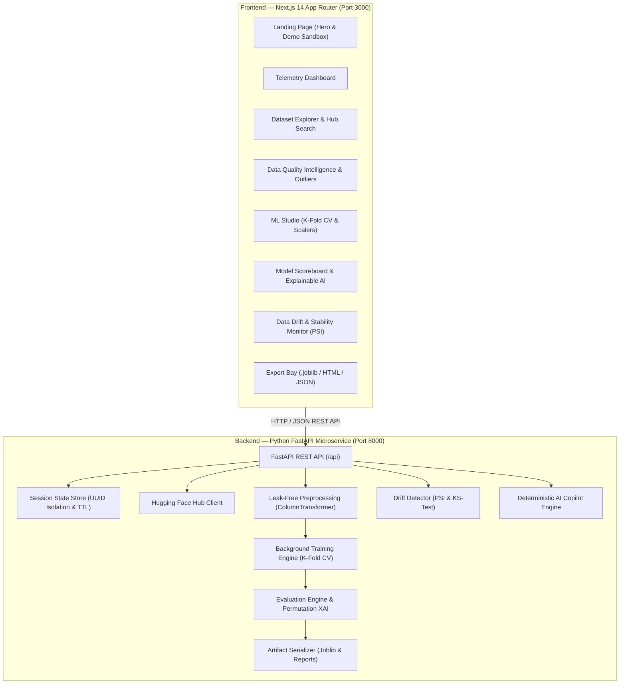

# OpenDataLens — AI-Powered Dataset Explorer & Model Evaluation Platform

[](https://opendatalens-app.vercel.app)
[](https://nextjs.org/)
[](https://fastapi.tiangolo.com/)
[](https://scikit-learn.org/)
[](https://www.typescriptlang.org/)
[](https://tailwindcss.com/)
[](tests/)
[](LICENSE)

**OpenDataLens** is a modern, developer-first machine learning workbench and automated model evaluation platform. Built as a full-stack SaaS application, OpenDataLens streamlines the end-to-end data science lifecycle: from discovering and streaming public datasets on Hugging Face, to comprehensive statistical data quality profiling, leak-free Scikit-learn pipeline training, cross-model benchmarking tournaments, Explainable AI (Permutation Importance), Data Drift monitoring (PSI & KS tests), and one-click production artifact exports.

Designed with a sleek, dark-mode SaaS interface inspired by platforms like Linear, Vercel, Supabase, and Hugging Face, OpenDataLens emphasizes high information density, subtle borders, glowing data accents, and zero data leakage.

---

## Live Production Deployment

- **Production Frontend (Vercel)**: [https://opendatalens-app.vercel.app](https://opendatalens-app.vercel.app)
- **GitHub Repository**: [https://github.com/deepakpradhan1021/OpenDataLens](https://github.com/deepakpradhan1021/OpenDataLens)

---

## Key Capabilities

- **Remote Dataset Discovery & Ingestion**: Stream datasets directly from the Hugging Face Hub using the Datasets API, load instant curated benchmarks (Iris, California Housing, Wine Recognition, Wisconsin Breast Cancer, Diabetes, Titanic Synthetic Demo), or drag-and-drop local CSV files (up to 25 MB) with automatic delimiter sniffing (commas, tabs, semicolons, pipes).
- **Cryptographic Workspace Session Isolation**: Every browser session automatically initializes a unique, unguessable UUIDv4 workspace. Datasets, evaluations, experiments, and background training jobs are isolated in memory with configurable session TTL and 1-click workspace clearing.
- **Automated Data Quality Profiling & Anomaly Detection**: Instant dataset health auditing: compute completeness scores, detect duplicate rows, visualize missingness ratios with bar charts, compute numeric Pearson correlation heatmaps, analyze distribution moments (skewness, variance, unique counts), identify numerical outliers via Interquartile Range (IQR), flag high-cardinality categoricals, and detect potential target leakage (|r| >= 0.95).
- **Leak-Free ML Training Studio with K-Fold Cross Validation**: Automated task and target heuristics (identifying suitable classification or regression targets via entropy and cardinality checks). Configurable feature subsets, train/test split ratio, 5-Fold Stratified K-Fold / K-Fold cross validation, random seeds, and preprocessing scalers (`StandardScaler`, `RobustScaler`, `MinMaxScaler`). All transformations fit strictly on the training partition to guarantee mathematical zero data leakage.
- **Explainable AI (XAI)**: Understand model predictions via Permutation Feature Importance computed on held-out test splits, eliminating collinearity distortion. Inspect native model weights (tree feature importances, linear coefficients) and local individual prediction feature attributions.
- **Data Drift Detection & Monitoring**: Dedicated drift monitoring page comparing baseline reference datasets to evaluation partitions or uploaded target CSVs. Calculates Population Stability Index (PSI) and two-sample Kolmogorov-Smirnov (KS) statistics for continuous features, and Total Variation Distance (TVD) for categoricals.
- **Reproducible Experiment History Tracking**: Immutable session run logs storing dataset fingerprints, target columns, feature subsets, model architectures, hyperparameters, CV fold mean ± standard deviation scores, and JSON export.
- **AI Dataset Copilot**: Zero-cost deterministic heuristic intelligence engine answering questions about dataset composition, missing value cleaning priorities, outlier mitigations, and model performance comparisons without external API dependencies.
- **Production Artifact & Dossier Export**: Download serialized `.joblib` model binaries ready for production deployment, standalone interactive HTML dossiers with embedded styles and charts, machine-readable JSON evaluation summaries, and formatted GitHub README markdown snippets.

---

## Architecture Overview



---

## Project Structure

```text
OpenDataLens/
├── backend/                        # FastAPI Python Microservice
│   ├── api/
│   │   ├── main.py                 # FastAPI entrypoint, CORS & error handling
│   │   ├── models.py               # Pydantic schemas & response models
│   │   ├── session_store.py        # Cryptographic UUID workspace isolation & TTL
│   │   └── routes/                 # Modular REST API route handlers
│   │       ├── copilot.py          # AI Dataset Copilot endpoint
│   │       ├── datasets.py         # Ingestion, validation & workspace clearing
│   │       ├── drift.py            # Data Drift & PSI analysis endpoints
│   │       ├── evaluation.py       # Model showdown & Explainable AI (XAI)
│   │       ├── health.py           # Dynamic telemetry health endpoint
│   │       ├── ml.py               # ML Studio training job & experiment logs
│   │       ├── quality.py          # Quality profiling & IQR outliers
│   │       └── reports.py          # Downloadable HTML, JSON, and .joblib exports
│   ├── requirements.txt            # Python dependencies (scikit-learn, scipy, etc.)
│   └── run_server.py               # Local server runner
├── core/                           # Core Machine Learning & Data Engine
│   ├── config.py                   # Authoritative benchmark catalog & tokens
│   ├── copilot.py                  # Deterministic AI reasoning engine
│   ├── dataset_loader.py           # Ingestion, sniffing, and HF integration
│   ├── drift_detector.py           # PSI, KS-test, and categorical TVD engine
│   ├── evaluator.py                # Leaderboard ranking & permutation XAI
│   ├── ml_studio.py                # Pipeline construction, K-Fold CV, & fitting
│   ├── quality_analyzer.py         # Quality profiling, IQR outliers, & leakage
│   ├── report_generator.py         # Multi-format report builder
│   └── visualizer.py               # Visualizations & distribution plotting
├── frontend/                       # Modern Next.js 14 SaaS Web Application
│   ├── src/
│   │   ├── app/                    # Next.js App Router pages
│   │   │   ├── page.tsx            # Landing Page & Try Demo Sandbox
│   │   │   ├── dashboard/page.tsx  # Telemetry Dashboard
│   │   │   ├── drift/page.tsx      # Data Drift Detection Page
│   │   │   ├── explorer/page.tsx   # Dataset Explorer & Ingestion
│   │   │   ├── quality/page.tsx    # Quality Intelligence & Copilot
│   │   │   ├── studio/page.tsx     # ML Training Studio (K-Fold CV)
│   │   │   ├── comparison/page.tsx # Model Scoreboard & Explainability (XAI)
│   │   │   └── reports/page.tsx    # Evaluation Reports & Model Export
│   │   ├── components/             # Reusable UI components & navigation
│   │   └── lib/                    # API client, workspace UUID, TypeScript types
│   ├── tests/                      # Playwright end-to-end test suite
│   ├── package.json                # Frontend dependencies
│   ├── tailwind.config.ts          # Modern dark-mode theme configuration
│   └── playwright.config.ts        # E2E test runner configuration
├── tests/                          # Backend Pytest test suite (67 tests)
└── .github/
    └── workflows/
        └── ci.yml                  # Automated GitHub Actions CI pipeline
```

---

## Authoritative Curated Benchmark Catalog

OpenDataLens maintains an authoritative offline-ready dataset catalog:

| Dataset ID | Name | Rows | Features | Target | Task | Source |
| :--- | :--- | :--- | :--- | :--- | :--- | :--- |
| `iris` | Iris Flower Dataset | 150 | 4 | `target` | Classification | scikit-learn |
| `wine_recognition` | Wine Recognition Benchmark | 178 | 13 | `target` | Classification | scikit-learn (UCI Repository) |
| `california_housing` | California Housing Prices | 20,640 | 8 | `MedHouseVal` | Regression | scikit-learn |
| `breast_cancer` | Breast Cancer Wisconsin | 569 | 30 | `target` | Classification | scikit-learn |
| `diabetes` | Diabetes Progression | 442 | 10 | `target` | Regression | scikit-learn |
| `titanic_synthetic` | Titanic Survival (Synthetic Demo) | 891 | 8 | `Survived` | Classification | Synthetic Benchmark Demo |

*Note on Backward Compatibility: Legacy IDs `wine_quality`, `titanic`, and `titanic_sample` automatically resolve to their canonical benchmarks.*

---

## Getting Started

### Prerequisites

- **Python**: 3.10, 3.11, 3.12, or 3.13
- **Node.js**: 18.x, 20.x, or 22.x
- **Git**

---

### 1. Backend Setup (FastAPI)

```bash
# Navigate to project root
cd OpenDataLens

# Create and activate Python virtual environment
python -m venv .venv

# On Windows:
.venv\Scripts\activate
# On macOS / Linux:
source .venv/bin/activate

# Install dependencies
pip install -r backend/requirements.txt
pip install pytest pytest-asyncio httpx

# Launch FastAPI server
python backend/run_server.py
```

The FastAPI backend microservice will start at `http://localhost:8000`.
Interactive Swagger documentation is available at `http://localhost:8000/docs`.

---

### 2. Frontend Setup (Next.js 14)

```bash
# In a new terminal, navigate to the frontend directory
cd OpenDataLens/frontend

# Install dependencies
npm install

# Start development server
npm run dev

# Or build and run production server
npm run build
npm start
```

Open `http://localhost:3000` in your browser.

---

## Verification & Automated Testing

OpenDataLens includes complete test suites covering both the Python ML backend and the Next.js frontend.

### 1. Backend Unit & Integration Tests (Pytest)

Run all 67 backend tests covering session isolation, dataset ingestion, data drift detection (PSI/KS), permutation explainability, Stratified K-Fold cross validation, IQR outliers, and FastAPI endpoints:

```bash
pytest -v
```

```text
============================= 67 passed in 6.45s ==============================
```

### 2. End-to-End Automated Browser Tests (Playwright)

Run Playwright tests across both desktop and mobile viewports:

```bash
cd frontend
npm run test:e2e
```

---

## Production Deployment

### Frontend (Vercel)
The Next.js 14 frontend is preconfigured for instant deployment on Vercel:
1. Connect this GitHub repository to Vercel.
2. Set the Root Directory to `frontend`.
3. Configure the environment variable:
   `NEXT_PUBLIC_API_URL=https://<your-render-backend-url>/api`
4. Deploy!

### Backend (Render)
A `backend/render.yaml` blueprint is included:
```yaml
services:
  - type: web
    name: opendatalens-api
    env: python
    buildCommand: pip install -r backend/requirements.txt
    startCommand: uvicorn backend.api.main:app --host 0.0.0.0 --port $PORT
```

---

## Known Limitations & Roadmap

- **In-Memory Session Store**: Workspace state is stored in server memory with TTL expiration. For multi-replica distributed horizontal scaling, Redis can be introduced as the backing session store.
- **Single-Machine Training**: Estimators execute on local CPU threads via Scikit-learn. Distributed cluster training (e.g. Ray / Spark) is planned for future releases.
- **Multimodal Datasets**: Current release specializes in tabular and structured benchmark datasets. Image and audio dataset exploration is on the roadmap.

---

## License

This project is licensed under the MIT License — see the [LICENSE](LICENSE) file for details.
