# OpenDataLens — AI-Powered Dataset Explorer & Model Evaluation Platform

[](https://opendatalens-app.vercel.app)
[](https://nextjs.org/)
[](https://fastapi.tiangolo.com/)
[](https://scikit-learn.org/)
[](https://www.typescriptlang.org/)
[](https://tailwindcss.com/)
[](tests/)
[](frontend/tests/)
[](LICENSE)

**OpenDataLens** is a modern, developer-first machine learning workbench and automated model evaluation platform. Built as a full-stack SaaS application, OpenDataLens streamlines the end-to-end data science lifecycle: from discovering and streaming public datasets on Hugging Face, to comprehensive statistical data quality profiling, leak-free Scikit-learn pipeline training, cross-model benchmarking tournaments, and one-click production artifact exports.

Designed with a sleek, dark-mode SaaS interface inspired by platforms like Linear, Vercel, Supabase, and Hugging Face, OpenDataLens emphasizes high information density, subtle borders, glowing data accents, and zero data leakage.

---

## Key Capabilities

- **Remote Dataset Discovery & Ingestion**: Stream datasets directly from the Hugging Face Hub using the Datasets API, load instant curated benchmarks (Iris, California Housing, Wine Quality, Wisconsin Breast Cancer, Diabetes, Titanic), or drag-and-drop local CSV files with automatic delimiter sniffing (commas, tabs, semicolons, pipes).
- **Automated Data Quality Profiling**: Instant dataset health auditing: compute completeness scores, detect duplicate rows, visualize missingness ratios with bar charts, compute numeric Pearson correlation heatmaps, analyze distribution moments (skewness, variance, unique counts), and generate actionable data-hygiene diagnostic warnings.
- **Leak-Free ML Training Studio**: Automated task and target heuristics (identifying suitable classification or regression targets via entropy and cardinality checks). Configurable feature subsets, train/test split ratio, random seeds, and preprocessing scalers (`StandardScaler`, `RobustScaler`, `MinMaxScaler`). All transformations fit strictly on the training partition to guarantee mathematical zero data leakage.
- **Asynchronous Training Workers**: Train multiple Scikit-learn algorithms concurrently on background workers with non-blocking polling and real-time step streaming. Supported models include Logistic Regression, Random Forest, Gradient Boosting, Extra Trees, Ridge, Lasso, and ElasticNet.
- **Model Showdown & Tournament Leaderboard**: Automated cross-model benchmarking ranked by task-specific metrics (Accuracy, Macro F1, Precision, Recall, and ROC AUC for classification; RMSE, MAE, and R² for regression). Includes interactive confusion matrix heatmaps and residual distribution plots.
- **Production Artifact & Dossier Export**: Download serialized `.joblib` model binaries ready for production deployment, standalone interactive HTML dossiers with embedded styles and charts, machine-readable JSON evaluation summaries, and formatted GitHub README markdown snippets.

---

## Architecture Overview

```mermaid
flowchart LR
    subgraph Frontend["Frontend — Next.js 14 App Router (Port 3000)"]
        LANDING["Landing Page (Hero & Terminal)"]
        DASH["Telemetry Dashboard"]
        EXP["Dataset Explorer & Hub Search"]
        QUAL["Data Quality Profiler & Correlation"]
        STUDIO["ML Studio (Pipeline Configuration)"]
        COMP["Model Comparison & Leaderboard"]
        REP["Export Bay (.joblib / HTML / JSON)"]
    end

    subgraph Backend["Backend — Python FastAPI Microservice (Port 8000)"]
        ROUTER["FastAPI REST API (/api)"]
        SESSION["Session State Store (Thread-Safe)"]
        HF_CLIENT["Hugging Face Hub Client"]
        PREPROC["Leak-Free Preprocessing (ColumnTransformer)"]
        TRAINER["Background Training Engine"]
        EVAL["Scikit-learn Evaluation Engine"]
        EXPORTER["Artifact Serializer (Joblib & Reports)"]
    end

    Frontend -->|HTTP / JSON REST API| ROUTER
    ROUTER --> SESSION
    ROUTER --> HF_CLIENT
    ROUTER --> PREPROC
    PREPROC --> TRAINER
    TRAINER --> EVAL
    EVAL --> EXPORTER
```



---

## Project Structure

```text
OpenDataLens/
├── backend/                        # FastAPI Python Microservice
│   ├── api/
│   │   ├── main.py                 # FastAPI application entrypoint & CORS middleware
│   │   └── routes/                 # Modular REST API route handlers
│   │       ├── datasets.py         # Curated, HF Hub, and CSV ingestion endpoints
│   │       ├── evaluation.py       # Model showdown & confusion matrix endpoints
│   │       ├── health.py           # Health check and telemetry endpoints
│   │       ├── ml.py               # ML Studio training job dispatcher
│   │       ├── quality.py          # Statistical profiling & distributions
│   │       └── reports.py          # Downloadable HTML, JSON, and .joblib exports
│   ├── requirements.txt            # Python dependencies
│   └── run_server.py               # Local server startup runner
├── core/                           # Core Machine Learning & Data Engine
│   ├── dataset_loader.py           # Ingestion, sniffing, and HF integration
│   ├── evaluator.py                # Leaderboard ranking & metric computation
│   ├── ml_studio.py                # Pipeline construction & background fitting
│   ├── quality_analyzer.py         # Statistical profiling & recommendations
│   ├── report_generator.py         # Multi-format report builder
│   └── visualizer.py               # Visualizations & distribution plotting
├── frontend/                       # Modern Next.js 14 SaaS Web Application
│   ├── src/
│   │   ├── app/                    # Next.js App Router pages
│   │   │   ├── page.tsx            # Landing Page
│   │   │   ├── dashboard/page.tsx  # Telemetry Dashboard
│   │   │   ├── explorer/page.tsx   # Dataset Explorer & HF Ingestion
│   │   │   ├── quality/page.tsx    # Data Quality Profiler
│   │   │   ├── studio/page.tsx     # ML Training Studio
│   │   │   ├── comparison/page.tsx # Model Showdown Leaderboard
│   │   │   └── reports/page.tsx    # Evaluation Reports & Model Export
│   │   ├── components/             # Reusable UI components & navigation
│   │   └── lib/                    # API client, TypeScript definitions
│   ├── tests/                      # Playwright end-to-end test suite
│   ├── package.json                # Frontend dependencies
│   ├── tailwind.config.ts          # Modern dark-mode theme configuration
│   └── playwright.config.ts        # E2E test runner configuration
├── tests/                          # Backend Pytest test suite (48 tests)
└── .github/
    └── workflows/
        └── ci.yml                  # Automated GitHub Actions CI pipeline
```

---

## Getting Started

### Prerequisites

- **Python**: 3.10, 3.11, 3.12, or 3.13
- **Node.js**: 18.x, 20.x, or 22.x
- **Git**

---

### 1. Backend Setup (FastAPI)

```bash
# Navigate to project root
cd OpenDataLens

# Create and activate Python virtual environment
python -m venv .venv

# On Windows:
.venv\Scripts\activate
# On macOS / Linux:
source .venv/bin/activate

# Install dependencies
pip install -r backend/requirements.txt
pip install pytest pytest-asyncio httpx

# Launch FastAPI server
python backend/run_server.py
```

The FastAPI backend microservice will start at `http://localhost:8000`.
Interactive Swagger documentation is available at `http://localhost:8000/docs`.

---

### 2. Frontend Setup (Next.js 14)

```bash
# In a new terminal, navigate to the frontend directory
cd OpenDataLens/frontend

# Install dependencies
npm install

# Start development server
npm run dev

# Or build and run production server
npm run build
npm start
```

Open `http://localhost:3000` in your browser.

---

## Verification & Automated Testing

OpenDataLens includes complete test suites covering both the Python ML backend and the Next.js frontend.

### 1. Backend Unit & Integration Tests (Pytest)

Run all 48 backend tests covering dataset ingestion, delimiter sniffing, quality profiling, Scikit-learn training pipelines, zero data leakage constraints, and FastAPI endpoints:

```bash
pytest -v
```

```text
============================= 48 passed in 8.29s =============================
```

### 2. End-to-End Automated Browser Tests (Playwright)

Run Playwright tests across both desktop and mobile viewports:

```bash
cd frontend
npx playwright test
```

```text
Running 14 tests using 1 worker
  ok  1 [chromium] › 1. Landing Page renders branding, hero and navigation (1.3s)
  ok  2 [chromium] › 2. Dataset Explorer loads curated dataset into active memory (621ms)
  ok  3 [chromium] › 3. Data Quality Profiler displays completeness and stats (605ms)
  ok  4 [chromium] › 4. ML Studio configures and runs model training workflow (2.6s)
  ok  5 [chromium] › 5. Model Comparison displays leaderboard and metrics (625ms)
  ok  6 [chromium] › 6. Reports page provides direct download endpoints (569ms)
  ok  7 [chromium] › 7. Mobile responsive viewport test (486ms)
  ok  8 [mobile-chrome] › 1. Landing Page renders branding, hero and navigation (1.4s)
  ok  9 [mobile-chrome] › 2. Dataset Explorer loads curated dataset into active memory (701ms)
  ok 10 [mobile-chrome] › 3. Data Quality Profiler displays completeness and stats (643ms)
  ok 11 [mobile-chrome] › 4. ML Studio configures and runs model training workflow (2.7s)
  ok 12 [mobile-chrome] › 5. Model Comparison displays leaderboard and metrics (745ms)
  ok 13 [mobile-chrome] › 6. Reports page provides direct download endpoints (695ms)
  ok 14 [mobile-chrome] › 7. Mobile responsive viewport test (1.0s)

  14 passed (18.7s)
```

---

## Production Deployment

### Frontend (Vercel)
The Next.js 14 frontend is preconfigured for instant deployment on Vercel:
1. Connect this GitHub repository to Vercel.
2. Set the Root Directory to `frontend`.
3. Configure the environment variable:
   `NEXT_PUBLIC_API_URL=https://<your-render-backend-url>/api`
4. Deploy!

### Backend (Render)
A `backend/render.yaml` blueprint is included:
```yaml
services:
  - type: web
    name: opendatalens-api
    env: python
    buildCommand: pip install -r backend/requirements.txt
    startCommand: uvicorn backend.api.main:app --host 0.0.0.0 --port $PORT
```

---

## License

This project is licensed under the MIT License — see the [LICENSE](LICENSE) file for details.
