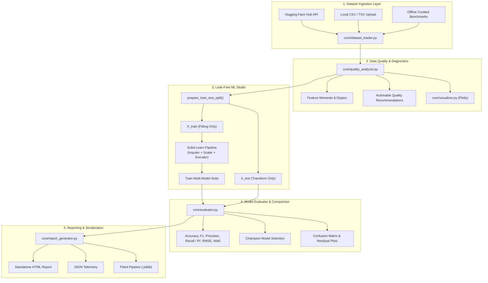

# OpenDataLens — AI-Powered Dataset Explorer & Model Evaluation Platform

[](https://www.python.org/downloads/)
[](https://streamlit.io/)
[](https://scikit-learn.org/)
[](https://plotly.com/)
[](tests/)
[](LICENSE)

**OpenDataLens** is an open-source, full-stack machine learning workbench and data intelligence platform. It bridges the gap between raw data discovery and production model evaluation by combining **Hugging Face Hub exploration**, **automated data quality profiling**, **leak-free Scikit-learn machine learning pipelines**, **multi-model performance benchmarking**, and **interactive report generation**.

---

## Table of Contents

- [Overview](#overview)
- [Key Features](#key-features)
- [System Architecture](#system-architecture)
- [Technology Stack](#technology-stack)
- [Installation & Setup](#installation--setup)
- [Quick Start Guide](#quick-start-guide)
- [Visual Interface & Walkthrough](#visual-interface--walkthrough)
- [Real Benchmark Results](#real-benchmark-results)
- [Project Directory Structure](#project-directory-structure)
- [Automated Testing & Verification](#automated-testing--verification)
- [Roadmap & Future Enhancements](#roadmap--future-enhancements)
- [License](#license)

---

## Overview

Data scientists and ML engineers frequently lose hours writing repetitive exploratory scripts, handling delimiter errors, inadvertently introducing data leakage during scaling/imputation, and writing boilerplate evaluation code.

**OpenDataLens** solves this by providing a unified, enterprise-grade dashboard that:
1. Connects seamlessly to the **Hugging Face Hub** and **Dataset Viewer API** as well as local CSV files.
2. Performs **automated data health audits** (detecting missing value patterns, duplicates, constant columns, and cardinality risks).
3. Constructs **strict, zero-leakage Scikit-learn pipelines** (`ColumnTransformer` + estimators) for Classification and Regression.
4. Trains multiple baseline architectures simultaneously and ranks them on a **multi-metric scoreboard**.
5. Packages fitted pipelines into **deployable `.joblib` bundles** alongside executive HTML/JSON reports.

---

## Key Features

### 1. Dataset Explorer
- **Hugging Face Hub Integration:** Live keyword and task search across public Hugging Face datasets with likes, downloads, and tags metadata.
- **Dataset Viewer API Streaming:** Directly streams rows from remote Hugging Face datasets into local DataFrames.
- **Robust CSV Ingestion:** Automatic delimiter sniffing (comma, semicolon, tab, pipe), multi-encoding support (`utf-8`, `latin1`, `iso-8859-1`), and bad-line recovery.
- **Offline Curated Benchmarks:** Instant 1-click loading for standard benchmarks (Iris, Wine Quality, California Housing, Breast Cancer, Diabetes, Titanic).
- **Interactive Metadata Preview:** Memory footprint calculation, missing cell counts, and column specification inspection.

### 2. Data Quality & Integrity Profiler
- **Health KPI Metrics:** Real-time calculation of overall completeness score, duplicate row percentage, and null cell density.
- **Visual Missingness Diagnostics:** Interactive Plotly column missingness bar charts and sparsity matrix heatmaps.
- **Distribution & Collinearity Engine:** Dynamic numeric histograms, categorical frequency charts, and Pearson correlation heatmaps.
- **Rule-Based Recommendations:** Automated, color-coded diagnostic alerts flagging severe missingness (>40%), zero-variance constant columns, potential ID/key leakage, and class distribution imbalances.

### 3. Machine Learning Studio
- **Dual Problem Support:** Seamless configuration for **Classification** (binary & multi-class) and **Regression** (continuous variables).
- **Intelligent Target Discovery:** Heuristic target candidate ranking based on cardinality, data types, and semantic naming.
- **Zero-Leakage Preprocessing:**
  - *Numerical:* Median imputation + configurable scaling (`StandardScaler`, `RobustScaler`, `MinMaxScaler`).
  - *Categorical:* Mode imputation + `OneHotEncoder(handle_unknown='ignore')`.
  - Encapsulated strictly inside `ColumnTransformer` fitted solely on training partitions.
- **Stratified & Shuffled Splitting:** Automatic stratified partitioning for classification with fallback for rare class scenarios.
- **Baseline Architectures:**
  - *Classification:* Logistic Regression, Random Forest, Gradient Boosting, Decision Trees, K-Nearest Neighbors, Support Vector Classifier (SVC).
  - *Regression:* Ridge Regression, Linear Regression, Random Forest Regressor, Gradient Boosting Regressor, Decision Tree Regressor, K-Nearest Neighbors.

### 4. Model Comparison & Deep Evaluation
- **Champion Model Selection:** Automatically detects and crowns the highest-performing model based on domain primary metrics ($F_1$-Macro for classification, $R^2$ Score for regression).
- **Side-by-Side Scoreboard:** Comparative multi-metric ranking table including training runtime in seconds.
- **Interactive Metric Visualizer:** Plotly bar charts highlighting the champion model in warm amber accent.
- **Deep Model Inspection:**
  - *Classification:* Interactive Confusion Matrix heatmaps and granular per-class Precision/Recall/$F_1$/Support breakdown.
  - *Regression:* Residual scatter plots ($y_{true} - y_{pred}$) with zero-error reference line, and Actual vs. Predicted parity plots ($y = x$).

### 5. Report Generation & Artifact Export
- **Standalone HTML Reports:** Self-contained, responsive HTML reports styled with custom CSS tokens, KPI summaries, and performance tables.
- **Structured JSON Telemetry:** Complete machine-readable audit trail for MLOps CI/CD pipelines.
- **Markdown Reports:** GitHub-ready markdown summaries for issue tracking and PR descriptions.
- **Inference-Ready Model Export:** Download serialized `.joblib` pipelines containing the fitted preprocessor coupled to the trained model for instant deployment via `pipeline.predict()`.
- **Dataset Export:** Download sanitized or processed datasets as CSV.

---

## System Architecture



---

## Technology Stack

| Layer | Component | Description |
| :--- | :--- | :--- |
| **Frontend UI** | Streamlit | Responsive reactive dashboard with UI/UX Pro Max Enterprise theme |
| **Data Processing** | Pandas & NumPy | Vectorized operations, missingness masks, moments calculation |
| **Machine Learning** | Scikit-learn | Pipelines, ColumnTransformers, Estimators, and Metrics |
| **Data Connectors** | Requests & HF Hub API | Hugging Face Dataset Viewer API and Hub query engine |
| **Visualizations** | Plotly & Matplotlib | Interactive HTML5 charts, confusion matrices, correlation heatmaps |
| **Serialization** | Joblib | High-efficiency compression and storage of scikit-learn pipelines |
| **Quality Assurance**| Pytest | Automated unit, edge-case, and integration testing suite |

---

## Installation & Setup

### Prerequisites
- Python 3.10+ (tested on Python 3.13)
- Git

### 1. Clone the Repository
```bash
git clone https://github.com/your-username/OpenDataLens.git
cd OpenDataLens
```

### 2. Create and Activate Virtual Environment
```bash
# Windows (PowerShell)
python -m venv .venv
.\.venv\Scripts\Activate.ps1

# Linux / macOS
python3 -m venv .venv
source .venv/bin/activate
```

### 3. Install Dependencies
```bash
pip install -r requirements.txt
```

---

## Quick Start Guide

### Launching the Application
Execute the following command in your terminal:
```bash
streamlit run app.py
```
Open your browser at `http://localhost:8501`.

### End-to-End Walkthrough
1. **Load Data:** In the **Dataset Explorer** tab, click **"Load Iris Flower Dataset"** or drag-and-drop a CSV file.
2. **Review Quality:** Navigate to **Data Quality Analysis** to inspect completeness score, duplicate count, correlation heatmaps, and quality alerts.
3. **Configure & Train:** Switch to **ML Studio**, select your target column and feature subset, pick your scaler, select baseline algorithms (e.g., Logistic Regression, Random Forest, Decision Tree), and click **"Train Models"**.
4. **Compare Models:** Open **Model Comparison** to review the performance scoreboard, inspect the Champion model, and analyze the interactive Confusion Matrix.
5. **Export Deliverables:** Visit **Reports & Export** to download the standalone HTML report, JSON telemetry, and the serialized `.joblib` model artifact.

---

## Visual Interface & Walkthrough

The interface adheres to the **UI/UX Pro Max Data-Dense Dashboard** design principles:
- **Primary Color:** Tech Navy (`#1E40AF`)
- **Accent Color:** Warm Amber (`#D97706`)
- **Background Canvas:** Slate 50 Neutral (`#F8FAFC`)
- **Card Surfaces:** Pure White with subtle borders (`#E2E8F0`)
- **Typography:** Inter (body) & Fira Code (metrics/code)

```
+---------------------------------------------------------------------------------------+
|  OPENDATALENS | AI-Powered Dataset Explorer & Model Evaluation Platform               |
+---------------------------------------------------------------------------------------+
| [Navigation]       |  [Active Dataset: Iris Flower Dataset (150 rows x 5 cols)]       |
|                    |                                                                  |
| > Dataset Explorer |  +-------------------+  +-------------------+  +---------------+ |
|   Data Quality     |  | Total Rows: 150   |  | Completeness: 100%|  | Memory: 0.1MB | |
|   ML Studio        |  +-------------------+  +-------------------+  +---------------+ |
|   Model Comparison |                                                                  |
|   Reports & Export |  [Missing Value Distribution]      [Feature Correlation Matrix]  |
|                    |  +-------------------------+      +---------------------------+  |
|                    |  |       Plotly Bar        |      |      Plotly Heatmap       |  |
|                    |  +-------------------------+      +---------------------------+  |
+---------------------------------------------------------------------------------------+
```

---

## Real Benchmark Results

The following evaluation metrics were produced by OpenDataLens running on standard test benchmarks with an 80/20 train/test split:

### Classification Benchmark (Iris Multi-Class)
| Model Architecture | Accuracy | $F_1$ Score (Macro) | Precision (Macro) | Recall (Macro) | Training Time |
| :--- | :---: | :---: | :---: | :---: | :---: |
| **Random Forest Classifier** | **0.9667** | **0.9665** | 0.9697 | 0.9667 | 0.082s |
| **Decision Tree Classifier** | 0.9333 | 0.9326 | 0.9388 | 0.9333 | 0.005s |
| **Logistic Regression** | 0.9333 | 0.9326 | 0.9388 | 0.9333 | 0.021s |

*Champion Model: Random Forest Classifier ($F_1 = 0.9665$)*

### Regression Benchmark (Diabetes Quantitative Progression)
| Model Architecture | $R^2$ Score | RMSE | MAE | MSE | Training Time |
| :--- | :---: | :---: | :---: | :---: | :---: |
| **Ridge Regression** | **0.4988** | **52.34** | 42.11 | 2739.4 | 0.006s |
| **Linear Regression** | 0.4952 | 52.53 | 42.30 | 2759.1 | 0.008s |
| **Random Forest Regressor** | 0.4412 | 55.27 | 45.18 | 3054.8 | 0.114s |

*Champion Model: Ridge Regression ($R^2 = 0.4988$)*

---

## Project Directory Structure

```
OpenDataLens/
├── .gitignore                      # Git ignore specifications
├── LICENSE                         # MIT License
├── README.md                       # Comprehensive documentation
├── requirements.txt                # Production and development dependencies
├── app.py                          # Streamlit main entrypoint & navigation
├── core/                           # Core Machine Learning & Analytics Engines
│   ├── __init__.py
│   ├── config.py                   # Design tokens, palette, constants & dataset presets
│   ├── dataset_loader.py           # HF Hub search, HF Dataset Viewer API, CSV parsing
│   ├── quality_analyzer.py         # Missingness profiling, duplicates, data type inference
│   ├── ml_studio.py                # Leak-free Scikit-learn pipelines & estimator factories
│   ├── evaluator.py                # Performance metrics, confusion matrices, comparison logic
│   ├── report_generator.py         # HTML, JSON, and Markdown report rendering engine
│   └── visualizer.py               # Plotly interactive figures & custom dashboard styling
├── ui/                             # Presentation Layer & Dashboard Views
│   ├── __init__.py
│   ├── styles.py                   # UI/UX Pro Max CSS design tokens & card styling
│   ├── components.py               # Reusable widgets (KPI cards, alerts, empty states)
│   ├── page_dataset_explorer.py    # HF search, CSV upload, and curated benchmark loader
│   ├── page_data_quality.py        # Missing values, correlation heatmaps, feature moments
│   ├── page_ml_studio.py           # Feature selection, preprocessing, and model fitting
│   ├── page_model_comparison.py    # Scoreboard, champion card, and confusion matrices
│   └── page_report_export.py       # Downloadable reports and Joblib model export
├── tests/                          # Automated Pytest Suite (42 Tests)
│   ├── __init__.py
│   ├── test_dataset_loader.py      # Tests for HF API and CSV parsing
│   ├── test_quality_analyzer.py    # Tests for quality metrics & recommendation engine
│   ├── test_ml_studio.py           # Tests for leak-free pipelines and splits
│   ├── test_evaluator.py           # Tests for metrics and model comparison
│   ├── test_visualizer.py          # Tests for Plotly figure generators
│   ├── test_report_generator.py    # Tests for HTML/JSON/Markdown reports & model export
│   ├── test_edge_cases.py          # Tests for corrupted CSVs, single-class targets, NaNs
│   └── test_app_integration.py     # End-to-end integration workflows
└── docs/                           # Architecture Specifications & Superpowers Plans
    └── superpowers/
        └── plans/
            └── 2026-11-09-opendatalens-implementation.md
```

---

## Automated Testing & Verification

OpenDataLens features a comprehensive automated test suite spanning unit tests, edge-case failure mode validations, and end-to-end workflow integrations.

### Running Tests
```bash
pytest -v
```

### Test Suite Execution Output
```text
tests/test_app_integration.py::test_end_to_end_classification_workflow PASSED
tests/test_app_integration.py::test_end_to_end_regression_workflow PASSED
tests/test_dataset_loader.py::test_get_sample_datasets_list PASSED
tests/test_dataset_loader.py::test_load_curated_dataset_iris PASSED
tests/test_dataset_loader.py::test_load_curated_dataset_california PASSED
tests/test_dataset_loader.py::test_load_curated_dataset_invalid PASSED
tests/test_dataset_loader.py::test_load_csv_dataset_standard PASSED
tests/test_dataset_loader.py::test_load_csv_dataset_semicolon PASSED
tests/test_dataset_loader.py::test_load_csv_dataset_empty_error PASSED
tests/test_dataset_loader.py::test_search_hf_datasets_mock_or_network PASSED
tests/test_edge_cases.py::test_corrupted_delimiter_csv PASSED
tests/test_edge_cases.py::test_csv_with_all_nans_in_one_column PASSED
tests/test_edge_cases.py::test_single_class_target_failure PASSED
tests/test_edge_cases.py::test_missing_feature_column_in_split PASSED
tests/test_edge_cases.py::test_insufficient_samples_split PASSED
tests/test_edge_cases.py::test_zero_division_evaluator PASSED
tests/test_edge_cases.py::test_empty_comparison_table PASSED
tests/test_evaluator.py::test_evaluate_classification_model PASSED
tests/test_evaluator.py::test_evaluate_regression_model PASSED
tests/test_evaluator.py::test_build_comparison_table PASSED
tests/test_evaluator.py::test_get_best_model_summary PASSED
tests/test_ml_studio.py::test_detect_target_candidates_classification PASSED
tests/test_ml_studio.py::test_detect_target_candidates_regression PASSED
tests/test_ml_studio.py::test_prepare_train_test_split PASSED
tests/test_ml_studio.py::test_train_classification_pipeline PASSED
tests/test_ml_studio.py::test_train_regression_pipeline PASSED
tests/test_quality_analyzer.py::test_detect_column_types PASSED
tests/test_quality_analyzer.py::test_analyze_data_quality_metrics PASSED
tests/test_quality_analyzer.py::test_generate_quality_recommendations PASSED
tests/test_quality_analyzer.py::test_empty_dataframe_quality PASSED
tests/test_report_generator.py::test_generate_html_report PASSED
tests/test_report_generator.py::test_generate_json_report PASSED
tests/test_report_generator.py::test_generate_markdown_report PASSED
tests/test_report_generator.py::test_export_model_pipeline_bytes PASSED
tests/test_visualizer.py::test_plot_missing_values_bar PASSED
tests/test_visualizer.py::test_plot_missing_matrix PASSED
tests/test_visualizer.py::test_plot_correlation_heatmap PASSED
tests/test_visualizer.py::test_plot_feature_distribution_numeric PASSED
tests/test_visualizer.py::test_plot_feature_distribution_categorical PASSED
tests/test_visualizer.py::test_plot_confusion_matrix_heatmap PASSED
tests/test_visualizer.py::test_plot_regression_residuals PASSED
tests/test_visualizer.py::test_plot_model_comparison_bar PASSED

============================= 42 passed in 4.54s =============================
```

---

## Roadmap & Future Enhancements

- [ ] **Automated Hyperparameter Optimization:** Integration with Optuna for automated Bayesian tuning across candidate architectures.
- [ ] **SHAP & Feature Importance Explainability:** Visualizing global and local feature attributions using TreeSHAP and KernelSHAP.
- [ ] **Direct Hugging Face Model Hub Push:** Exporting fine-tuned models directly to Hugging Face Model repositories with automated model cards (`README.md`).
- [ ] **Outlier Detection Studio:** Automated Isolation Forest and Local Outlier Factor (LOF) anomaly filtering.
- [ ] **Time-Series Forecasting:** Expanding beyond classification and regression to handle temporal sequences with rolling-window cross-validation.

---

## License

This project is licensed under the MIT License - see the [LICENSE](LICENSE) file for details.
