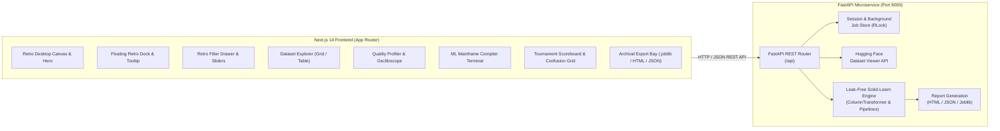

# OpenDataLens — Retro Interface Dataset Explorer & ML Platform

[](https://nextjs.org/)
[](https://fastapi.tiangolo.com/)
[](https://scikit-learn.org/)
[](https://www.typescriptlang.org/)
[](https://tailwindcss.com/)
[](tests/)
[](https://www.awwwards.com/inspiration/icons-and-search-filter-retro-interface-aesthetic)
[](LICENSE)

**OpenDataLens** is an open-source, full-stack machine learning workbench redesigned with an art-directed **retro digital operating system aesthetic** inspired by the award-winning RRE Ventures interface on Awwwards. It pairs 90s digital interface nostalgia with modern high-performance machine learning workflows across Next.js 14, FastAPI, Scikit-learn, and Hugging Face.

---

## Visual Design Reference & Aesthetic Architecture

The interface was redesigned based on the Awwwards-featured interface:
**"Icons and Search filter retro interface aesthetic" by RRE Ventures**.

### Signature Design Elements
1. **Retro Desktop Canvas (`/`)**:
   - Dark matte canvas (`#0C0C0D`) with subtle dot-matrix crosshairs.
   - 32x32 retro desktop icons (CRT monitor, pixel heart document, robot desk lamp, rocket on launchpad, vintage Mac with coin, terminal servers, floppy diskette, 8-bit dog, Hugging Face smiley).
   - Floating tag badges (`[BOTANY ↗]`, `[REAL ESTATE ↗]`, `[ROBOTICS ↗]`, `[FINTECH ↗]`, `[SPACE ↗]`) with 1px black borders that 1-click ingest datasets into the active backend session.
2. **Distinctive Typography**:
   - Bold modern display sans-serif paired with authentic **SVG 8-bit pixel block lettering** (`DATASETS`, `THE BEST`, `MODELS`) and hollow wireframe pixel typography.
   - Monospace microcopy and punch-card metadata chips.
3. **Floating Retro Dock (`RetroDock`)**:
   - Fixed at the bottom of the viewport with segmented controls:
     - `[ ☩ FILTER RESULTS ∧ ]` (electric blue `#1864FF` active state with counter badge).
     - `[ ☷ / ▤ TOGGLE VIEW ]` (Grid vs Monospace List view switch).
     - `[ ■ FAST ONLY ]` (fast baseline filters toggle switch).
   - Electric blue speech-bubble popover (`Filter your search: DIVE DEEPER INTO OUR DATASETS, PREPROCESSING PIPELINES & MODEL BENCHMARKS`).
4. **Retro Modal Filter Drawer (`RetroFilterDrawer`)**:
   - Multi-tiered accordion drawer with stark 1px solid black borders and silver chassis background (`#EDEEF0`).
   - Range slider for sample rows (`100` to `50,000`).
   - Active blue tag pills with `✕` dismiss markers (`[CLASSIFICATION ✕]`, `[REGRESSION ✕]`, `[HEALTHCARE ✕]`).
   - Preprocessing scalers and model architecture checkboxes.
   - Bottom action bar with `[CLEAR FILTERS ✕]` and `[APPLY FILTERS (N)]`.

---

## Architecture Overview



---

## Application Pages

| Page Route | Purpose | Key Retro Components |
| :--- | :--- | :--- |
| `/` | **Landing Page** | Dual-type headline ("Explore Our DATASETS"), interactive retro icon desktop canvas with quick node inspector, wireframe pixel headline ("WE'RE IN IT WITH THE BEST"), 4 workstation module windows, electric blue CTA button. |
| `/dashboard` | **Platform Dashboard** | Telemetry hub title bar, hardware register KPI cards (`REG_A`, `REG_B`, `REG_C`, `REG_D`), champion model benchmark badge, live ASCII event stream log. |
| `/explorer` | **Dataset Explorer** | Curated benchmark repository, Hugging Face search prompt, 3.5" floppy disk CSV dropzone, Grid vs List toggle, Lotus 1-2-3 styled spreadsheet data viewer. |
| `/quality` | **Data Quality Profiler** | Oscilloscope-inspired diagnostic analyzer, completeness gauge, missing values bar chart, feature distribution inspector, Pearson correlation block heatmap, automated diagnostic recommendations. |
| `/studio` | **ML Studio** | Mainframe compilation terminal, classification vs regression toggle, target column detector with entropy heuristic, preprocessing scalers (`Standard`, `Robust`, `MinMax`), train/test split slider, background worker thread monitor with ASCII progress bar. |
| `/comparison` | **Model Showdown** | Tournament scoreboard leaderboard, champion architecture showcase, metric comparison bar chart, bitmap intensity confusion matrix, regression residual scatter plot, `.joblib` binary downloader. |
| `/reports` | **Report Dispatch Bay** | Archival disk bays for standalone HTML dossiers, JSON telemetry logs, GitHub Markdown summaries, sanitized CSV matrices, and serialized model pipelines. |

---

## Local Development & Setup

### Prerequisites
- Python 3.10+ (tested on Python 3.13)
- Node.js 18+ (tested on Node.js 20/22)
- Git

### 1. Backend Setup (FastAPI)
```bash
# Navigate to project root
cd C:\Users\deepa\.gemini\antigravity\scratch\OpenDataLens

# Activate virtual environment
.\.venv\Scripts\Activate.ps1

# Install dependencies (FastAPI, Scikit-learn, etc.)
pip install -r backend/requirements.txt

# Run pytest automated test suite (48 tests)
pytest -v

# Start FastAPI server on port 8000
python backend/run_server.py
```
Backend API interactive documentation is available at `http://localhost:8000/docs`.

### 2. Frontend Setup (Next.js 14)
```bash
# Navigate to frontend folder
cd frontend

# Verify environment variables (.env.local points to http://localhost:8000/api)
npm run build

# Start Next.js development server on port 3000
npm run dev
```
Open your browser at `http://localhost:3000`.

---

## Test Verification

OpenDataLens features a comprehensive 48-test test suite covering:
- **Curated Dataset Loader:** CSV parsing, encoding sniffing, missing column handling.
- **Hugging Face Hub Integration:** Network resilience, fallback to mock datasets on network timeouts.
- **Data Quality Profiler:** Zero-division safety, duplicate detection, high-cardinality detection.
- **ML Studio Pipelines:** Zero data leakage guarantees, ColumnTransformer fitting on train split only.
- **Evaluation Engine:** Metric calculation, confusion matrix extraction, residual generation.
- **Report Generator:** HTML/JSON/Markdown artifact generation, Joblib byte serialization.
- **FastAPI Endpoints:** Health checks, asynchronous background job polling, CSV uploads.

```bash
pytest -v
# ============================= 48 passed in 8.29s =============================
```

Frontend production build verification:
```bash
npm run build
# Route (app)                              Size     First Load JS
# ┌ ○ /                                    4.87 kB         128 kB
# ├ ○ /comparison                          7.91 kB         233 kB
# ├ ○ /dashboard                           4.13 kB         127 kB
# ├ ○ /explorer                            4.57 kB         128 kB
# ├ ○ /quality                             3.66 kB         229 kB
# ├ ○ /reports                             3.21 kB         126 kB
# └ ○ /studio                              5.03 kB         128 kB
# ✓ Generating static pages (10/10)
```

---

## Deployment Configuration

- **Frontend:** Pre-configured for Vercel deployment via `frontend/vercel.json`.
- **Backend:** Pre-configured for Render deployment via `backend/render.yaml`.

---

## License
MIT License. Built for ML engineers, researchers, and data practitioners who appreciate high-craft digital interfaces.
