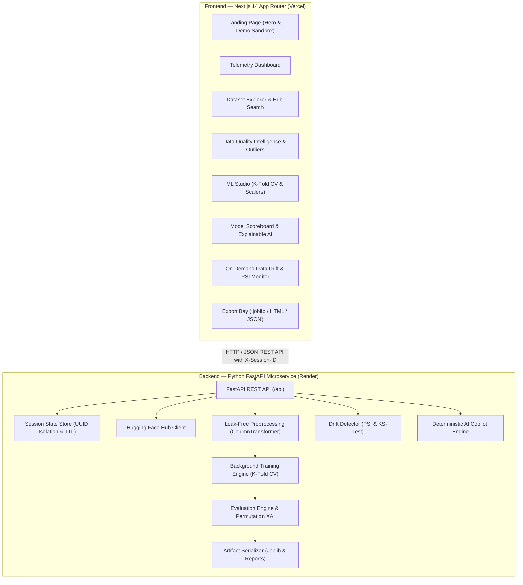

# OpenDataLens — AI-Powered Dataset Explorer & Model Evaluation Platform

<div align="center">

[](https://opendatalens-app.vercel.app)
[](https://opendatalens.onrender.com/docs)
[](https://github.com/deepakpradhan1021/OpenDataLens/actions/workflows/ci.yml)
[-10B981?style=for-the-badge&logo=pytest&logoColor=white)](tests/)
[](LICENSE)

**A portfolio-grade machine learning workbench and automated model evaluation platform.**  
*Discover, profile, evaluate, explain, and benchmark machine learning models with zero data leakage.*

[**Live Web Application**](https://opendatalens-app.vercel.app) • [**Interactive Swagger Docs**](https://opendatalens.onrender.com/docs) • [**System Health**](https://opendatalens.onrender.com/api/health) • [**Report a Bug**](https://github.com/deepakpradhan1021/OpenDataLens/issues)

</div>

---

> [!NOTE]
> **Portfolio Platform Context:** OpenDataLens is an interactive portfolio and demonstration platform designed to showcase end-to-end ML engineering, clean architectural design, and rigorous validation. Workspaces utilize cryptographic session tokens with in-memory TTL caching rather than persistent enterprise accounts.

---

## Highlights & Features

| Capability | Technical Implementation | Highlights |
| :--- | :--- | :--- |
| **Workspace Session Isolation** | Cryptographic UUIDv4 tokens via `SessionStore` & TTL eviction | Multi-tenant session separation; zero cross-user state leakage; 1-click workspace clearing |
| **Explainable AI (XAI)** | `sklearn.inspection.permutation_importance` on held-out test split | Permutation Feature Importance, native model weights, single-sample prediction attribution |
| **On-Demand Data Drift** | Two-sample Kolmogorov-Smirnov (`scipy.stats.ks_2samp`) & PSI | Population Stability Index (PSI), distribution shift charts, categorical Total Variation Distance (TVD) |
| **Leak-Free ML Studio** | Stratified K-Fold / K-Fold (3, 5, 10 folds) with `ColumnTransformer` | Zero data leakage: standard/robust/minmax scalers fitted exclusively on training folds |
| **Quality Intelligence** | Interquartile Range (IQR) & 3-sigma z-score outlier detection | Target leakage flags (\|r\| ≥ 0.95), high-cardinality warnings, completeness scoring |
| **AI Dataset Copilot** | Deterministic heuristic reasoning engine | Grounded answers on quality, missing values, and model champions with 0 latency & 0 external API cost |
| **Artifact Export Bay** | Scikit-Learn `.joblib` serialization, HTML dossiers, JSON reports | Downloadable model binaries and standalone shareable audit dossiers |

---

## Live Deployments

- **Production Frontend (Vercel)**: [https://opendatalens-app.vercel.app](https://opendatalens-app.vercel.app)
- **Production Backend (Render)**: [https://opendatalens.onrender.com](https://opendatalens.onrender.com)
- **Interactive API Documentation (Swagger)**: [https://opendatalens.onrender.com/docs](https://opendatalens.onrender.com/docs)
- **Live Telemetry & Health**: [https://opendatalens.onrender.com/api/health](https://opendatalens.onrender.com/api/health)

---

## Architecture Overview



---

## Methodological Rigor & Technical Disclosures

### 1. Leak-Free Preprocessing Architecture
OpenDataLens guarantees strict prevention of data leakage:
- Imputers and scalers (`StandardScaler`, `RobustScaler`, `MinMaxScaler`) are fit **only on training folds** within `scikit-learn.pipeline.Pipeline` objects.
- In cross-validation, transformations are learned within each respective fold split, preventing test distribution leakage into the training phase.

### 2. Permutation Importance & Collinear Features
- Feature importance is calculated via `sklearn.inspection.permutation_importance` over the held-out validation split.
- **Collinearity Consideration:** When two or more features are strongly correlated, permuting one feature while preserving the others allows the model to access redundant predictive signal from the unpermuted feature. This can result in a smaller observed performance drop for both features. OpenDataLens surfaces the full correlation matrix in the Quality Intelligence profiler so practitioners can evaluate collinearity alongside permutation rankings.

### 3. On-Demand Drift Detection vs Continuous Monitoring
- The Data Drift module performs **on-demand statistical comparisons** across dataset partitions (e.g. baseline 50% vs evaluation 50%) or against an uploaded target CSV.
- It applies the **Population Stability Index (PSI)**, the **Two-Sample Kolmogorov-Smirnov Test** for continuous distributions, and **Total Variation Distance (TVD)** for categorical distributions.
- It is an on-demand auditing tool rather than a real-time event-streaming monitoring daemon.
- Partitions with $N < 10$ records report `Insufficient Data` to prevent false "Stable" classifications.

### 4. Workspace Session Lifetime
- Workspaces are ephemeral demo sessions indexed by cryptographically random UUIDv4 identifiers.
- State is held in a thread-safe in-memory session store with active TTL eviction and clean cancellation of running jobs upon workspace reset.

---

## Authoritative Curated Benchmark Catalog

| Dataset ID | Benchmark Name | Samples | Features | Target Column | Task Type | Source Attribution |
| :--- | :--- | :--- | :--- | :--- | :--- | :--- |
| `iris` | Iris Flower Classification | 150 | 4 | `target` | Multiclass | Scikit-Learn |
| `wine_recognition` | Wine Recognition Benchmark | 178 | 13 | `target` | Multiclass | Scikit-Learn (UCI ML Repository) |
| `california_housing` | California Housing Prices | 20,640 | 8 | `MedHouseVal` | Regression | Scikit-Learn (1990 U.S. Census) |
| `breast_cancer` | Wisconsin Breast Cancer Diagnostic | 569 | 30 | `target` | Binary | Scikit-Learn (WDBC) |
| `diabetes` | Diabetes Disease Progression | 442 | 10 | `target` | Regression | Scikit-Learn |
| `titanic_synthetic` | Titanic Survivorship Benchmark | 891 | 8 | `Survived` | Binary | Synthetic Demo Benchmark |

*Note: Legacy identifiers (`wine_quality`, `titanic`, `titanic_sample`) automatically resolve to their canonical catalog counterparts with backward compatibility.*

---

## Project Structure

```text
OpenDataLens/
├── backend/                        # Python FastAPI Microservice
│   ├── api/
│   │   ├── main.py                 # FastAPI entrypoint, CORS & error handling
│   │   ├── models.py               # Pydantic schemas & response models
│   │   ├── session_store.py        # Cryptographic UUID workspace isolation & TTL
│   │   └── routes/                 # Modular REST API route handlers
│   │       ├── copilot.py          # AI Dataset Copilot endpoint
│   │       ├── datasets.py         # Ingestion, validation & workspace clearing
│   │       ├── drift.py            # Data Drift & PSI analysis endpoints
│   │       ├── evaluation.py       # Model showdown & Explainable AI (XAI)
│   │       ├── health.py           # Dynamic telemetry health endpoint
│   │       ├── ml.py               # ML Studio training job & experiment logs
│   │       ├── quality.py          # Quality profiling & IQR outliers
│   │       └── reports.py          # Downloadable HTML, JSON, and .joblib exports
│   ├── requirements.txt            # Python dependencies (scikit-learn, scipy, etc.)
│   ├── render.yaml                 # Render Infrastructure-as-Code deployment blueprint
│   └── run_server.py               # Local Uvicorn server launcher
├── core/                           # Core Machine Learning & Data Engine
│   ├── config.py                   # Authoritative benchmark catalog & tokens
│   ├── copilot.py                  # Deterministic AI reasoning engine
│   ├── dataset_loader.py           # Ingestion, sniffing, and HF integration
│   ├── drift_detector.py           # PSI, KS-test, and categorical TVD engine
│   ├── evaluator.py                # Leaderboard ranking & permutation XAI
│   ├── ml_studio.py                # Pipeline construction, K-Fold CV, & fitting
│   ├── quality_analyzer.py         # Quality profiling, IQR outliers, & leakage
│   ├── report_generator.py         # Multi-format report builder
│   └── visualizer.py               # Distribution and matrix plotting
├── frontend/                       # Modern Next.js 14 SaaS Web Application
│   ├── src/
│   │   ├── app/                    # Next.js App Router pages
│   │   │   ├── page.tsx            # Landing Page & Try Demo Sandbox
│   │   │   ├── dashboard/page.tsx  # Telemetry Dashboard
│   │   │   ├── drift/page.tsx      # On-Demand Data Drift Detection
│   │   │   ├── explorer/page.tsx   # Dataset Explorer & Ingestion
│   │   │   ├── quality/page.tsx    # Quality Intelligence & Copilot
│   │   │   ├── studio/page.tsx     # ML Training Studio (K-Fold CV)
│   │   │   ├── comparison/page.tsx # Model Scoreboard & Explainability (XAI)
│   │   │   └── reports/page.tsx    # Evaluation Reports & Model Export
│   │   ├── components/             # UI components & navigation
│   │   └── lib/                    # API client, workspace UUID, TypeScript types
│   ├── tests/                      # Playwright end-to-end test suite
│   ├── package.json                # Frontend dependencies
│   ├── .eslintrc.json              # Next.js Core Web Vitals ESLint config
│   └── tailwind.config.ts          # Modern dark-mode theme configuration
├── tests/                          # Backend Pytest test suite (75 tests)
└── .github/
    ├── workflows/
    │   └── ci.yml                  # Automated GitHub Actions CI pipeline
    ├── ISSUE_TEMPLATE/             # GitHub Issue templates
    └── PULL_REQUEST_TEMPLATE.md    # Standardized PR template
```

---

## Local Development Quickstart

### Prerequisites
- **Python**: 3.10, 3.11, 3.12, or 3.13
- **Node.js**: 18.x, 20.x, or 22.x
- **Git**

### 1. Launch the Backend (FastAPI)
```bash
# Clone the repository
git clone https://github.com/deepakpradhan1021/OpenDataLens.git
cd OpenDataLens

# Create and activate Python virtual environment
python -m venv .venv

# On Windows:
.venv\Scripts\activate
# On macOS / Linux:
source .venv/bin/activate

# Install backend dependencies
pip install -r backend/requirements.txt
pip install pytest pytest-asyncio httpx

# Start the FastAPI server
python backend/run_server.py
```
*Backend runs on `http://localhost:8000`. Swagger documentation available at `http://localhost:8000/docs`.*

### 2. Launch the Frontend (Next.js 14)
```bash
# In a new terminal window
cd OpenDataLens/frontend

# Install dependencies
npm install

# Start development server
npm run dev
```
*Frontend runs on `http://localhost:3000` and connects to `http://localhost:8000/api`.*

---

## Verification & Testing

OpenDataLens maintains full automated test coverage across all layers:

### 1. Backend Test Suite (Pytest)
```bash
python -m pytest -v
```
```text
============================= 75 passed in 8.64s ==============================
```
Covers:
- `test_session_isolation.py`: UUID session validation, TTL eviction, cross-tenant isolation, running job cancellation on workspace reset, refusal of post-cancellation session recreation.
- `test_cross_validation.py`: Stratified K-Fold & K-Fold leak-free preprocessing.
- `test_drift_detector.py`: PSI calculation, Kolmogorov-Smirnov 2-sample tests, categorical TVD, insufficient sample size protection ($N<10$), schema/type mismatch detection.
- `test_explainability.py`: Permutation Feature Importance & prediction attributions.
- `test_quality_intelligence.py`: IQR outliers, high cardinality, and target leakage ($|r| \ge 0.95$).
- `test_copilot.py`: Deterministic dataset and model reasoning queries.
- `test_fastapi_endpoints.py`: All REST API routes, status codes, payload validation, target leakage 400 rejection, invalid feature 400 rejection, and job ownership 403 access control.

### 2. Frontend ESLint & Production Build
```bash
cd frontend
npm run lint
npm run build
```
```text
✔ No ESLint warnings or errors
Route (app)                              Size     First Load JS
┌ ○ /                                    6.8 kB          125 kB
├ ○ /comparison                          11.1 kB         230 kB
├ ○ /dashboard                           3.9 kB          126 kB
├ ○ /drift                               5.52 kB         123 kB
├ ○ /explorer                            4.44 kB         127 kB
├ ○ /quality                             6.91 kB         226 kB
├ ○ /reports                             2.6 kB          125 kB
└ ○ /studio                              4.84 kB         127 kB
+ First Load JS shared by all            87.5 kB
Exit code: 0
```

---

## Production Deployment Guide

### Deploying the Backend on Render
1. Create a new **Web Service** on [Render.com](https://render.com) and link this repository.
2. Configure settings:
   - **Root Directory:** *(leave blank / empty)*
   - **Build Command:** `pip install -r backend/requirements.txt`
   - **Start Command:** `uvicorn backend.api.main:app --host 0.0.0.0 --port $PORT`
3. Your live API will be available at `https://<your-service>.onrender.com`.

### Deploying the Frontend on Vercel
1. Import this repository on [Vercel.com](https://vercel.com).
2. Set **Root Directory** to `frontend`.
3. In **Settings → Environment Variables**, add:
   - **Key:** `NEXT_PUBLIC_API_URL`
   - **Value:** `https://<your-service>.onrender.com/api`
4. Click **Deploy**. The frontend connects directly to your live Render backend.

---

## Contributing

Contributions, issues, and feature requests are welcome!  
Feel free to check out the [issues page](https://github.com/deepakpradhan1021/OpenDataLens/issues).

1. Fork the Project.
2. Create your Feature Branch (`git checkout -b feature/AmazingFeature`).
3. Commit your Changes (`git commit -m 'feat: Add some AmazingFeature'`).
4. Push to the Branch (`git push origin feature/AmazingFeature`).
5. Open a Pull Request using our [PR Template](.github/PULL_REQUEST_TEMPLATE.md).

---

## License

Distributed under the MIT License. See [LICENSE](LICENSE) for more information.
